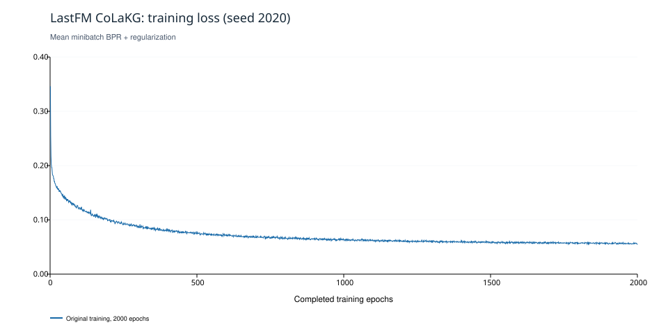
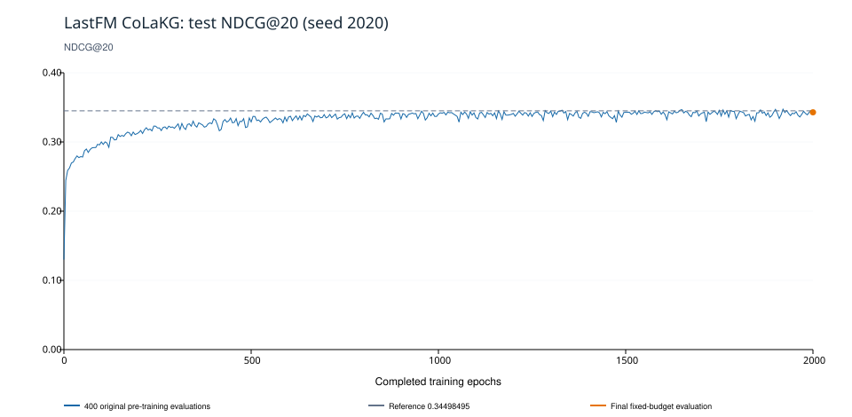

# LastFM 原始 CoLaKG：2000 轮基线复现

## 结论

已完成 **2000/2000 轮、114000 次 Adam 更新**，400 次原协议训练前测试及 1 次固定预算最终测试。全程从本次随机初始化开始，没有加载其他实验 checkpoint，没有修改模型结构、图传播、损失或超参数，没有按测试结果提前停止或调参。

| 指标口径 | 实际已训练轮数 | Precision@10 | Precision@20 | Recall@10 | Recall@20 | NDCG@10 | NDCG@20 |
| --- | ---: | ---: | ---: | ---: | ---: | ---: | ---: |
| 原协议 NDCG@20 最大观测点 | 1920 | 0.2001613771 | 0.1389456697 | 0.2706169898 | 0.3768675769 | 0.2954040348 | 0.3473341594 |
| 固定 2000 轮最终模型 | 2000 | 0.2007530931 | 0.1389725659 | 0.2725281129 | 0.3749863384 | 0.2922360183 | 0.3428422200 |

原协议 Recall@20 单独最大值为 **0.3809096886**，发生在已完成 **1650** 轮；它不一定与最大 NDCG 点相同。表中最佳行的所有指标来自同一个最大 NDCG@20 观测点。

参考 NDCG@20 为 **0.34498495**。原协议最大观测值与参考的有符号差为 **+0.0023492094**（+0.234921 个百分点，参考相对差 +0.6810%）；固定 2000 轮最终值差为 **-0.0021427300**。此处只比较给定参考数值，不能据此宣称模型创新或性能提升。

**评估局限：**“最佳”是在同一测试集上反复观察 400 次后的最大值，存在测试集选择偏差，属于原作者代码报告口径；不是通过验证集选择得到的独立结论。最终模型严格取固定 2000 轮预算，另行调用原始 Test，但仍使用同一测试集，不能视为新增独立留出集。单种子复现不提供多种子均值或显著性结论。

## 配置、环境与版本

- 项目：`D:\GitHub\colakg\CoLaKG`；分支：`exp/colakg-improvement`。
- 启动时 Git HEAD：`090c42832d22c7c328c869a0360e5c049af5f973`；正式入口当时是待提交的新文件，实际执行 SHA-256：`e6cc9c9908b2aaa957eb5da10d1bd284db3c12319ac5128c9d225fce48c51ce6`。运行目录保留相同源码副本，提交后可按此哈希追溯；脚本与本报告的保存提交可用 `git log -1 -- experiments/lastfm_baseline.md` 查询。
- 解释器：`D:\CondaEnvs\CoLaKG\python.exe`，3.8.19 | packaged by conda-forge | (default, Mar 20 2024, 12:38:07) [MSC v.1929 64 bit (AMD64)]。
- 依赖：torch 1.13.0、numpy 1.24.4、pandas 2.0.3、scipy 1.10.1、scikit-learn 1.3.2、tensorboardX 2.6.2.2、tqdm 4.66.4；CUDA runtime 11.7；设备 NVIDIA GeForce MX450，2 GiB。未安装新依赖，未修改其他环境。
- 完整 world 配置：`{"A_n_fold": 100, "A_split": false, "bigdata": false, "bpr_batch_size": 1024, "decay": 0.0001, "dropout_i": 0.6, "dropout_n": 0.6, "dropout_u": 0.2, "keep_prob": 1.0, "latent_dim_rec": 64, "lightGCN_n_layers": 3, "lr": 0.001, "multicore": 0, "neighbor_k": 10, "pretrain": 0, "test_u_batch_size": 100, "use_drop_edge": 0}`。
- seed=2020，epochs=2000，topks=[10, 20]；Adam 参数见运行目录 `status.json`/`result.json` 的 optimizer 字段。BPR 显式正则 0.0001，Adam 自身 weight_decay=0，未加调度器、AMP 或梯度裁剪。
- 1859 用户、2813 物品、57786 训练交互、13508 测试交互。输入来自当前仓库原始 LastFM 划分与已提供语义张量，不重新生成嵌入，不改数据划分。

| 输入 | 字节数 | SHA-256 |
| --- | ---: | --- |
| `data\lastfm\train.txt` | 250308 | `643619d1afd8d9bfbe536d0b9369b160bee932f69fdb59329132fcc07ade65a1` |
| `data\lastfm\test.txt` | 66449 | `0857015b628798e95e195daed6f9b289ab3bf888519e1c6445525de867f0008e` |
| `data\lastfm\lastfm_embeddings_simcse_kg.pt` | 11522934 | `8d826d30a8bac4a25fcde9e98dc4f7116da6fda954f05dae764de86634e64fab` |
| `data\lastfm\lastfm_embeddings_simcse_kg_user.pt` | 7615350 | `8ce9c4d833a9f17937478c76ccdff0ea1214b5b347e4ff2232562a63dc593215` |

## 实际执行协议

读取原始 `train_lastfm.sh`，通过未修改的 `world.py` 解析。新脚本只隔离路径、记录日志、检查有限值并保存同次恢复状态；每轮调用原始 `Procedure.BPR_train_original`，每次评估调用原始 `Procedure.Test`。模型、Adam 和 BPRLoss 复用原类。

每轮使用原始 Python 回退负采样（`utils.UniformSample_original_python`）：抽取训练交互数规模的用户样本，为用户随机抽一个训练正例，再随机拒绝采样一个不在训练正例中的负例；neg_k=1。每轮实际采样 57786 个三元组，57 个 minibatch（56×1024+442），实际检查 Adam 步数与总更新数一致。

在 original epoch=0,5,...,1995 **训练开始前**评估，分别对应已完成训练轮数 0,5,...,1995。原 main 日志会显示 EPOCH[1]、[6]、...、[1996]，不能误读为已训练这些轮数。本次事件和 CSV 同时保留两种标签。第 0 次是随机模型评估。训练 2000 轮后额外执行一次最终测试，与原协议最大值分开保存。

原 TensorBoard BPR step 使用 `epoch * int(57786/1024) + batch_i`，相邻 epoch 的步号有一个重叠；本次保留该原始行为，曲线使用独立记录的实际 epoch 和真实更新数，避免误对齐。

## 耗时与显存

| 项目 | 实测 |
| --- | ---: |
| 训练循环合计（含采样、前反向、Adam、数值检查和原日志） | 7138.842 秒 |
| 其中原始负采样 | 2701.083 秒 |
| 其中 BPR stageOne 包裹耗时 | 4113.312 秒 |
| 有限值检查读数（与 stageOne 时间部分重叠，不可相加） | 827.100 秒 |
| 400+1 次评估合计 | 349.018 秒 |
| 每轮模型保存合计 | 29.010 秒 |
| 完整恢复快照保存合计 | 18.557 秒 |
| 两段实际运行合计（含准备及文件 I/O，不含停机等待） | 7601.096 秒（2.111 小时） |
| 从首次启动到最终完成的日历跨度（含中断等待） | 32823.950 秒（9.118 小时） |
| 每轮训练耗时中位数 / 最小 / 最大 | 3.540 / 3.282 / 4.618 秒 |
| 两段 PyTorch 进程峰值 allocated / reserved | 308.89 / 338.00 MiB |
| 首轮 / 最终轮平均 minibatch loss | 0.3457274304 / 0.0549161586 |

训练循环时间已经包含采样，不能再次相加。整卡监视日志包含桌面及其他程序占用，不能当作模型专属显存。恢复阶段峰值还包括反序列化快照暂存，不等于模型新增参数。未改系统电源计划，监视进程只在运行期间防止空闲休眠。原始 result 的 session_wall_seconds 仅是最终会话耗时；resource-audit.json 加上失败会话日志中的时钟值得到总实际运行时间，明确排除中断后的等待。完整快照耗时沿用原始计时，恢复点最近一次快照写入的极小尾部开销可能未包含在累计快照计时中。总耗时不包括此后作图和 Git 操作。

## 曲线与运行产物





原始值不平滑、不丢弃下降点：运行目录 `loss-curve.csv` 有 2000 行，`ranking-curves.csv` 有 401 行，保留 Precision/Recall/NDCG@10/20。绘图仅读取 JSON，不加载权重，使用独立附带绘图运行时的 ReportLab，不向 CoLaKG 环境安装绘图库。

本次独立运行目录：`D:\CoLaKGExperiments\lastfm-baseline-20261022-233837-33d715d8`。

- 完整日志：`console-*.log`、`segments/*.jsonl`、`monitor-*.jsonl`、`tensorboard/`。
- 配置与依赖：`manifest.json`、`pip-freeze.txt`、`conda-explicit.txt`、`conda-environment.yml`、`source/`、`uncommitted.patch`。
- 指标与状态：`training-history.json`、`evaluations.json`、`result.json`、`status.json`、完整曲线 CSV。
- 最终模型：`D:\CoLaKGExperiments\lastfm-baseline-20261022-233837-33d715d8\checkpoints\colakg-lastfm-latest.pth.tar`，SHA-256 `7a4e73b3ba1b79b98d3f6e1f8eb1a09c44d0d51ab02058ca42fcdb31a64cb6ba`。
- 同次恢复：`checkpoints/recovery-0.pt`、`recovery-1.pt` 和带 SHA-256 的 `recovery.json`。初始/每 10 轮保存模型、Adam、Python/NumPy/PyTorch CPU/CUDA RNG；两个槽轮换，不增长为 2000 个文件，不覆盖其他实验。实际会话日志数 2。

## 复现命令与协议差异

在 PowerShell 执行下列命令会**新建唯一目录并重新开始完整 2000 轮**，不会加载本次或其他旧模型：

```powershell
Set-Location 'D:\GitHub\colakg\CoLaKG'
$env:PYTHONNOUSERSITE = '1'
$env:TEMP = 'D:\CoLaKGCache\tmp'
$env:TMP = 'D:\CoLaKGCache\tmp'
$env:TORCH_HOME = 'D:\CoLaKGCache\torch'
$env:PIP_CACHE_DIR = 'D:\CoLaKGCache\pip'
$env:CONDA_PKGS_DIRS = 'D:\CoLaKGCache\conda-pkgs'
& 'D:\CondaEnvs\CoLaKG\python.exe' -B -u 'D:\GitHub\colakg\CoLaKG\experiments\lastfm_windows.py'
```

汇总而不训练、不加载权重：

```powershell
& 'D:\CondaEnvs\CoLaKG\python.exe' -B 'D:\GitHub\colakg\CoLaKG\experiments\summarize_lastfm_baseline.py' 'D:\CoLaKGExperiments\lastfm-baseline-20261022-233837-33d715d8'
```

恢复入口与监视器用法见 `full_baseline_plan.md`。Windows 适配器只替换原子输出函数，对 WinError 5/32/33 作有限重试，不消耗随机数、不跳过原始源码哈希检查；监视器通过 FileShare.ReadWrite|Delete 读取，避免阻止原子替换。恢复仅限同次运行、同样代码/数据/依赖，校验 manifest 与快照哈希后恢复全部 RNG，不从别的实验取权重。未宣称默认 CUDA 稀疏运算具备跨运行逐位确定性；后端设置在 manifest 中完整记录。

与原作者数学/训练协议一致；执行环境为 Windows/Python3.8/PyTorch1.13 CUDA11.7，使用 Python 负采样回退，I/O 路径改为 D 盘独立目录，新增数值检查、完整恢复快照与最终固定预算评估。这些差异不修改模型公式，但限制对参考值逐位一致的预期。未验证参考值所用硬件、编译采样后端与完整依赖快照，因此只报告实际数值差，不编造差异成因。

## 异常与完整性

所有已完成会话的完整性记录确认运行期间已跟踪项目文件内容、main 引用及实验分支保持不变。原始 `rec_code` 没有修改；所有训练输出位于本次 D 盘目录。没有加载其他实验 checkpoint，没有根据测试曲线调整配置。会话日志数为 2，失败记录数为 1。原始 result.json 中 status/phase 是完成前复制的字段，保留不改；最终完成状态联合核验 status.json=completed、result.success=true、completed_epochs=2000 及完整性记录，不依赖旧 status 字段。

首次运行在 2026-10-23 01:36:56 完成 1870 轮后，因 status.json 原子替换返回 PermissionError/WinError 5 停止。监视器读取与替换存在 Windows 文件共享竞争风险；实际原因可确定到文件替换失败，不能仅凭日志排除杀软等短暂占用。故障发生在第 1870 轮快照保存后、该轮次评估开始前，没有损失已完成训练更新。旧 status.json 没能写成 failed，failure-*.json 与进程退出才是此故障的最终状态依据。

经用户确认后，仅新增 Windows I/O 适配器并修正监视器共享读取。用真实 Windows 不允许删除共享的只读句柄复现占用，重试 4 次后替换成功，随机数状态不变；测试记录保存在 io-tests/。恢复输入快照已独立归档于 io-adaptations/，SHA-256 为 `1ccf529cab35033ab82e59e718101005b3df9f29030c798dff0340e7d72e1498`。适配器、原入口及同次快照校验均保留记录，原训练入口本身未改。恢复从已完成 1870 轮继续，实际训练历史保持 1..2000 唯一连续，没有重计回滚事件。

中断与恢复是本次执行协议的一项差异，已如实披露。完成了全部 2000 轮与原协议评估频率；未额外证明恢复路径与不中断 CUDA 运行逐位等价，不将此单次结果描述为独立无偏性能结论。最终汇总通过 epoch/评估频率/更新数/数值有限性/最终模型哈希及完整性检查。
