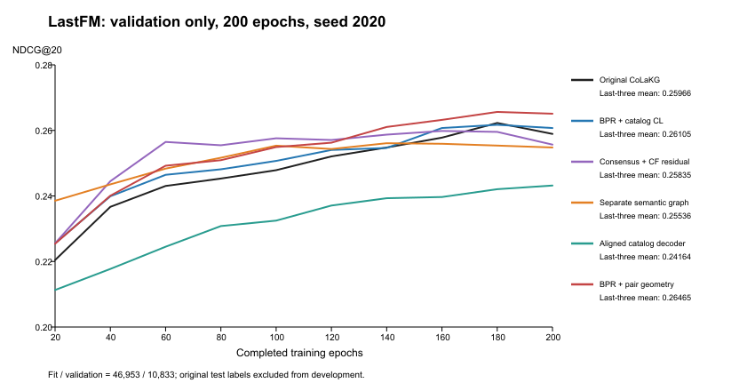
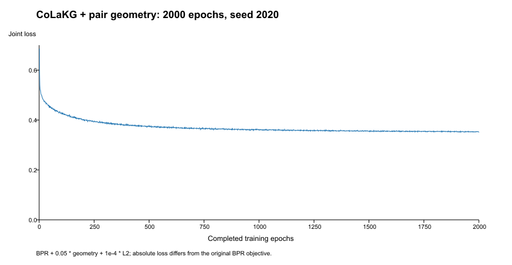

# CoLaKG LastFM 首轮方法研究报告

已完成五个方向、三种子开发确认、组件消融及冻结配置后的2000轮一次最终测试。以下保留所有负面结果，并区分开发、固定预算测试与历史测试峰值。

## 比较协议

保持已复现基线 exp/colakg-improvement@b98629e 与 main 不变，所有研究分支只在本地保存。未安装/升级依赖，未修改原始数据、语义资产或 rec_code 模型源码。新模型/目标位于 experiments/research_methods。所有训练从随机初始化开始；自己的训练快照只用于同次状态保存与明确标注的事后表示分析。

只从原train建立固定fit46953/validation10833，split_seed314159，用户1859、物品2813均保留。原test标签没有用于开发图、损失、方法比较、调参或选种子。每个开发实验200轮9200次原BPR_train_original更新，每20轮验证，事前固定160/180/200轮NDCG@20均值作为评分。以下0.26左右的数值全部是验证集，不能与历史0.3473测试数值直接作差。

共同参数：batch1024、dim64、3层、邻居10、lr0.001、decay0.0001、dropout_i/u/n=0.6/0.2/0.6，原Python负采样、Adam。模型框架改动和新增目标参数另记于各方法记录。评估缓存一次eval表示，仍使用原Procedure.Test、全排名和已知训练正例屏蔽。TensorBoard关闭，只改变记录开销。

环境：Windows，D:\CondaEnvs\CoLaKG\python.exe，Python3.8.19，PyTorch1.13.0/CUDA11.7，MX450 2GiB；完整pip清单在本轮study及最终运行目录。输入/源SHA、运行命令、每轮损失、指标和完整同次模型/Adam/RNG状态均在独立D盘目录。所有完成的运行源与输入哈希检查通过，没有NaN/OOM。

## 首轮方法与结果

| 方法（seed2020） | 末三次验证NDCG@20 | 配对变化 | 最终验证Recall@20 | 峰值allocated MiB | 循环秒 | 执行代码 |
|---|---:|---:|---:|---:|---:|---|
| 原始CoLaKG | 0.25966437 | +0.00% | 0.32817631 | 302.61 | 532.45 | e0e2a84 |
| 目录辅助对比 | 0.26105483 | +0.54% | 0.33313802 | 333.45 | 589.24 | 83b8fe7 |
| 共识邻居+协同残差 | 0.25834958 | -0.51% | 0.32748790 | 305.92 | 614.21 | f83ce1a |
| 独立语义图评分框架 | 0.25535919 | -1.66% | 0.32689362 | 56.03 | 466.09 | 2b05db3 |
| 余弦目录目标替换BPR | 0.24163837 | -6.94% | 0.32151374 | 332.16 | 642.90 | 88dac9f |
| 同类型表示几何辅助 | 0.26465053 | +1.92% | 0.33644817 | 322.89 | 564.99 | 8ba7eb3 |
| 仅对齐组件消融 | 0.23248324 | -10.47% | 0.29617754 | 302.61 | 506.68 | c8581e9 |

显存是PyTorch allocated峰值，不含驱动/其他程序；循环时间包括采样、训练、验证与状态保存，不含启动。单机有短时耗时波动，这些数值不是严格受控速度基准。损失包含不同辅助项，不能横向比较绝对值；完整损失见research_records/development_results_v1.json及各运行history.json。



路线覆盖监督目标、训练图邻居、独立协同评分与整体语义图框架，而非只修原注意力。目录辅助对比只有微小收益；共识重排/残差及独立语义图未改善验证；余弦目录目标在原参数下明显更差。以上仅是200轮筛选，不宣称这些框架在所有预算/数据上均无效。具体假设与限制分别见各方法中文记录。

## 初始化稳定性

| seed | 原始对照 | 目录辅助 | 目录变化 | 几何辅助 | 几何变化 |
|---|---:|---:|---:|---:|---:|
| 2020 | 0.25966437 | 0.26105483 | +0.54% | 0.26465053 | +1.92% |
| 2021 | 0.25759020 | 0.25908861 | +0.58% | 0.26224574 | +1.81% |
| 2022 | 0.25827144 | 0.25927061 | +0.39% | 0.26256669 | +1.66% |

目录辅助三种子平均配对提升约0.50%，未达新增种子训练前写下的1%推进门槛；没有对其执行原测试。几何辅助平均配对提升约1.80%，两新增种子均正，达到推进门槛。此为固定验证划分、短预算的初始化稳定性，不能声称三种子完整测试提升或论文级显著性。目标4%–5%尚未由开发结果证明。

## 机制证据及边界

仅对齐消融移除同类型logsumexp分散项，其验证分数0.23248324，相对原始对照-10.47%；完整几何项为0.26465053。对本轮自身200轮快照的CPU事后分析发现：仅对齐使fit正例余弦由0.68383升至0.79653，却使物品平均异节点余弦从0.07382升到0.24667，并伴随有效秩下降；完整几何项物品异节点余弦降至0.04072。

结果支持需要平衡交互对齐与表示分散的解释。完整几何项中心化有效秩并没有超过原始对照，不能包装成普遍的“提高秩”机制。分析不训练、不做原test排名，详见pair_geometry.md、research_records/geometry_analysis_v1.json；单种子关联和组件消融仍不足以证明普遍因果。

## 冻结后的完整训练

配置frozen_pair_geometry_v1.json在原测试前生成，完整校验源文件、原始资产、ID映射、种子、模型参数与共同配置。seed2020、2000轮、全部原train57786交互，从新随机初始化，禁止开发checkpoint作为起点。每20轮覆盖本次独立目录内的最新完整状态，只在完成2000轮后做一次原test。

运行目录：`D:\CoLaKGResearch\final-pair_geometry-s2020-20261023-171221-e3dfce`；启动提交 `06c2035bd5261fba7a0442ab6110727ce6d1f605`。最终完成2000轮、114000次更新、一次原测试；源/输入哈希通过。

| 指标 | 当前几何辅助最终模型 | 原始固定2000轮模型 |
|---|---:|---:|
| Recall@20 | 0.3819007915 | 0.3749863384 |
| NDCG@20 | 0.3490868273 | 0.3428422200 |

相对原始固定预算最终NDCG@20变化 **+1.8214%**；相对历史测试峰值0.3473341594变化 **+0.5046%**。本轮最终测试只有seed2020，不能声称多种子最终测试稳定提升或论文五次平均结论。

完整循环耗时7439.915秒（2.07小时），allocated峰值323.55MiB，reserved峰值344.00MiB，最终联合损失0.35129160。计时包括采样、训练、最终评估和状态保存；每轮training_seconds包含原Python采样。

其他最终指标：Precision@10/20=[0.2024744486282948, 0.14150080688542227]，Recall@10/20=[0.273525192755962, 0.3819007915161762]，NDCG@10/20=[0.295851535988988, 0.3490868273326837]。模型与优化器/RNG状态为该运行目录checkpoint.pt，完整日志console.log、history.json、evaluations.json、manifest.json、result.json、pip-freeze.txt。

耗时拆分：采样+训练合计7421.028秒，原评估函数计时0.706秒，其余状态保存、数值检查、日志及缓存表示等约18.181秒。入口未分别计采样和纯GPU训练，不能进一步拆分；原基线评估/保存更频繁，因此总时间差不能直接归因为算法加速。

该固定预算单种子测试相对原始最终模型有正收益，但完整测试尚未进行多种子配对确认。相对于已知原始最佳观测值的4%–5%研究目标尚未达到。

复现命令（在codex/pair-geometry分支，创建全新唯一输出目录）：

```powershell
& 'D:\CondaEnvs\CoLaKG\python.exe' -B -u D:\GitHub\colakg\CoLaKG\experiments\research_runner.py --method pair_geometry --phase final --epochs 2000 --seed 2020 --frozen-config D:\GitHub\colakg\CoLaKG\experiments\frozen_pair_geometry_v1.json
```

与历史原基线协议差异：原基线每5轮训练前评估并保留测试峰值，本次只在固定2000轮后评估；保存频率和日志方式不同，原训练超参数及负采样一致。主要比较历史最终2000轮NDCG@20=0.34284222、Recall@20=0.37498634；历史测试峰值0.34733416另列，不能把反复测试取最大、单次固定预算及论文五次平均混为一谈。

## 可追溯性与可信度限制

原始资产数据版本见lastfm_data_audit.md：仓库公开train/test共71294交互，与论文86608的统计差异仍未解释，但文件与原公开版本相同。公开用户语义的历史生成链不完整；开发划分只隔离监督图/标签，不证明语义资产层面完全无泄漏。所有对照沿用同一公开资产版本；独立语义图候选主动舍弃公开用户语义，属于其明确框架差异。

SGCL、LightCCF、CCLRec和AlphaRec论文/官方代码阅读及迁移差异见research_sources.md；几何辅助直接借鉴既有SGCL目标，保留BPR的做法也不是原SGCL单目标框架。它目前不是已证实的新损失或论文贡献。后续需要同预算强基线、更多完整种子、多数据集和针对性新机制，而不是改名包装。

本轮完成开发运行13次，合计2600轮、119600次更新、循环时间约124.6分钟；这部分是多个独立200轮开发实验之和；另有一个冻结后的2000轮完整候选，分开记录。原始基线分支和main不变；没有执行任何远程push。

| 方法分支 | 开发代码起点 | 本地结果记录提交 |
|---|---|---|
| research/catalog-contrastive | 83b8fe7 | d0068c8 |
| research/consensus-residual | f83ce1a | b8e1e77 |
| research/semantic-graph-decoder | 2b05db3 | d97d41e |
| research/aligned-catalog | 88dac9f | f3c98bd |
| codex/pair-geometry | 8ba7eb3 | 06c2035（完整训练执行版本；报告提交见本分支HEAD） |

复现各开发方法时，先切换表中相应分支，再用绝对Python/脚本路径执行：`D:\CondaEnvs\CoLaKG\python.exe -B -u D:\GitHub\colakg\CoLaKG\experiments\research_runner.py --method 方法名 --epochs 200 --seed 2020`。方法名按各中文记录；新输出全部在D盘且唯一命名。三种子原始对照、每个运行ID、原始数值与结果SHA保存在research_records/development_results_v1.json。

唯一启动失败为语义图候选的Python3.8相对源路径归档错误，发生在零更新时；修复启动路径后从头新运行，失败目录保留。无数据/语义资产/原模型公式被改写，无已发表或未发表研究分支被推送。

## Windows换行与严格哈希复现

历史冻结v1文件保持原样。Git的LF/CRLF转换可能改变字节哈希；`research_freeze_replay.py`逐文件核验当前代码及文本数据与训练提交06c2035的Git规范化内容完全相同，二进制语义资产哈希必须相同，然后只创建一个新冻结JSON，绝不改写代码/数据/历史记录，也不允许任意源变更通过。源与数据实际字节哈希记录在新清单里。

复现时先运行 `D:\CondaEnvs\CoLaKG\python.exe -B -u D:\GitHub\colakg\CoLaKG\experiments\research_freeze_replay.py`，再用输出的新路径替换完整训练命令的 `--frozen-config`。其余方法、seed2020与2000轮不变。如果源内容超出换行变化，脚本拒绝刷新，不能绕过。

## 本轮结论与后续优先级

得到小幅正收益候选，尚未达到相对历史最佳值4%–5%的目标。当前没有把它整合到稳定分支：完整预算测试仍只有一个种子。优先补充固定协议的完整预算种子2021/2022配对对照，检验效应是否持续；随后才考虑用仅训练图和语义共识为几何分散项提供置信权重，并与已有CCLRec/SGCL作强对照。这是待验证方向，不是已实现或已证实的创新。



绘图使用已有Codex附属Python中的ReportLab4.4.9和Sharp生成及核验SVG/PNG，没有给CoLaKG训练环境添加绘图依赖。研究的完整训练和开发阶段共14次运行；13次为独立200轮开发实验，另1次为冻结的2000轮最终实验，不能混成单次训练预算。

最终快照完整性见research_records/final_artifact_integrity.json；机器可读最终结果见research_records/final_pair_geometry_s2020.json。没有为本次快照完整性检查再次评估原test。
